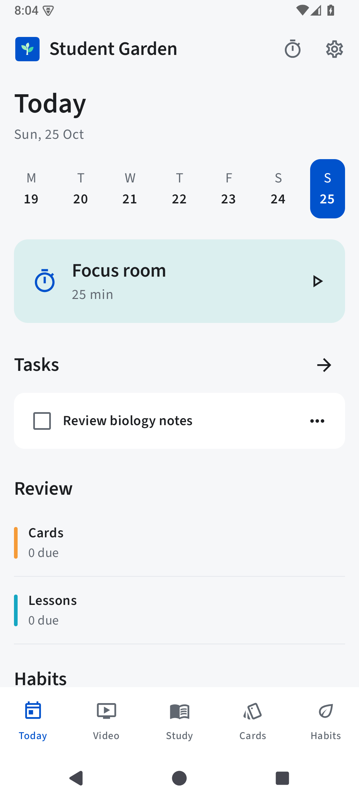
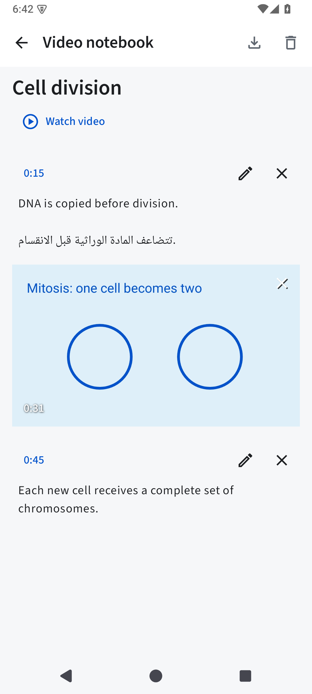
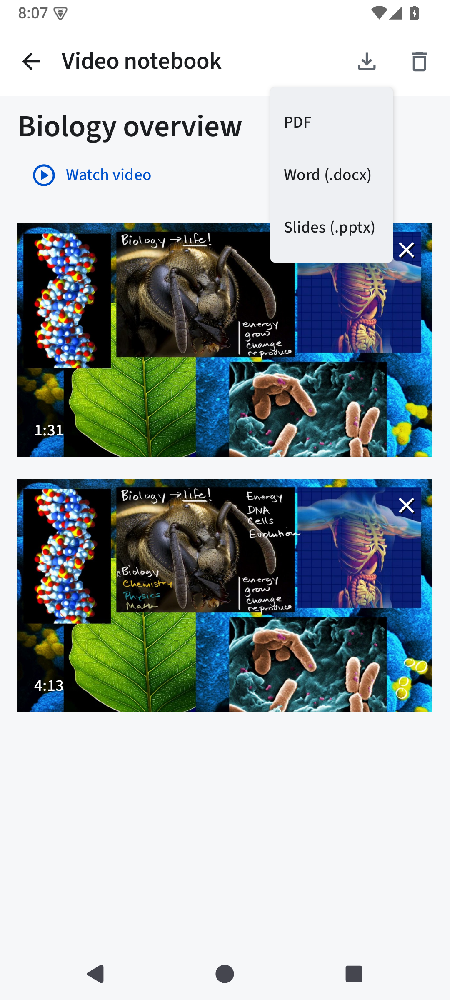
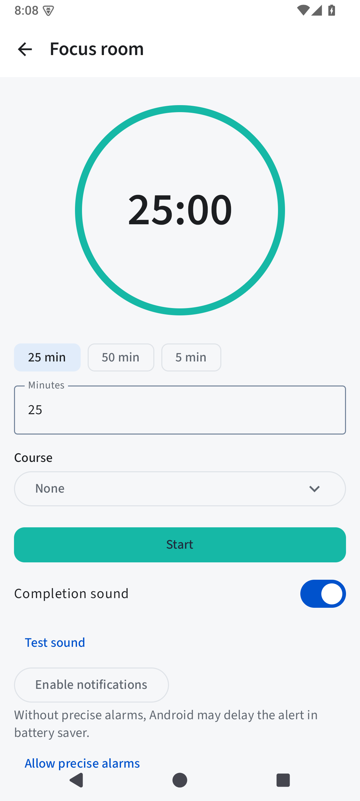
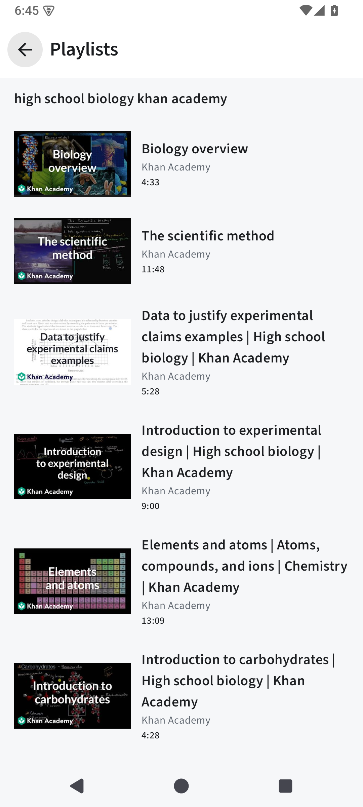

<p align="center">
  
</p>

<h1 align="center">Student Garden</h1>
<p align="center"><strong>A place to plan, learn and keep growing.</strong></p>
<p align="center">Plan your day, study a lesson, capture what matters and review it later.<br>One open-source Android workspace for your studies.</p>
<p align="center">v0.12.0 · Android 8.0+ · Kotlin &amp; Jetpack Compose · GPL-3.0-or-later<br>English · العربية · Français · Español</p>

<p align="center">
  <a href="https://github.com/ayoubelarfaoui097-png/student-garden/releases/download/v0.12.0/student-garden-0.12.0-preview.apk"><strong>Download v0.12.0 APK</strong></a> ·
  <a href="#screenshots">Screenshots</a> ·
  <a href="#whats-new-in-0120">What's new</a> ·
  <a href="#build-from-source">Build from source</a> ·
  <a href="CONTRIBUTING.md">Contribute</a>
</p>

Student Garden brings tasks, an agenda, rich notes, flashcards, lesson reviews,
habits and a focus timer together on your device. The optional Video area adds
public video lessons and timestamped notebooks, so you can keep an explanation,
a captured frame and the moment it came from together.

**Your study tools work offline. No account, ads or analytics.** Video search and
streaming require an Internet connection. Notes and document exports stay local.
[Privacy details](PRIVACY.md).

## Screenshots

<table>
  <tr><th>Plan your day</th><th>Keep a video notebook</th><th>Export your notes</th></tr>
  <tr>
    <td></td>
    <td></td>
    <td></td>
  </tr>
</table>

<table>
  <tr><th>Make time to focus</th><th>Explore video lessons</th></tr>
  <tr>
    <td></td>
    <td></td>
  </tr>
</table>

Actual Android emulator captures of v0.12.0, using fictional study records.
Video thumbnails and lesson imagery belong to their respective creators;
the cell-division illustration is generated test artwork.
[Full screenshot history and device evidence](docs/SCREENS.md).

## From a study plan to something you remember

| Area | What you can do |
| --- | --- |
| **Today** | Organize tasks, choose a day, see due reviews and enter the focus room. |
| **Video** | Search videos, playlists and channels; filter results; save lessons and resume playback. Keep timestamped text and captured frames in dedicated notebooks. |
| **Study** | Plan colored agenda sessions, organize courses, write rich notes with tables and audio, and review lessons after 48 hours, 7 days and one calendar month. |
| **Cards** | Create text, image and audio flashcards in decks. Reveal an answer and choose the next review interval. Due cards start in a shuffled order. |
| **Habits** | Schedule habits, record check-ins and follow streaks. |
| **Focus & settings** | Pause and resume a custom focus timer, configure local reminders, switch appearance or language, and manage backups and Trash. |

Rich notes include headings, bold, italic, underline, lists, editable tables, Undo
and Redo. Audio recording shows a timer, Stop control and live microphone waveform.
Light, dark and system appearance are available, with navigation that adapts to
wider screens.

## What's new in 0.12.0

- **Dedicated video notebooks.** Open **Video → Notebooks** for a continuous timeline
  of text and captured frames. Ordinary notes stay in Study. Tap a timestamp to
  return to its source position; edit text or remove a frame with Undo.
- **Capture while watching.** Save a clean frame in landscape fullscreen without
  changing whether playback is playing or paused. Capture and back controls hide
  with the player controls.
- **Take your notes with you.** Export text and images as **PDF**, **Word (.docx)**
  or **PowerPoint (.pptx)** through Android's document picker. Files are generated
  locally, with support for English and Arabic text. Audio is not embedded; rich
  Study-note formatting becomes plain text in exports.
- **Playlist loading fixed in optimized builds.** The extractor's required protobuf
  fields are retained when the APK is optimized.
- **Existing study work stays compatible.** Earlier rich content and recordings
  remain readable. Version 1 backups remain importable; version 2 includes saved
  videos and cannot be imported by older app versions.

Video playback uses NewPipeExtractor and a native Media3 player. There is no
automatic next video or recommendation feed. Availability depends on the remote
service and your connection.

## Install

Download [student-garden-0.12.0-preview.apk](https://github.com/ayoubelarfaoui097-png/student-garden/releases/download/v0.12.0/student-garden-0.12.0-preview.apk)
from the [v0.12.0 release](https://github.com/ayoubelarfaoui097-png/student-garden/releases/tag/v0.12.0)
and open it on **Android 8.0 or later**. Allow installation from your file app if
Android asks. The installable app is named **Student Garden Preview**.

**Updating Preview:** export a backup in Settings, then install over the existing
app to retain its records. The v0.12.0 Preview uses the same package and signing
certificate as v0.11.0. Avoid uninstalling first: uninstalling removes local data.

For reminders, open **Settings → Reminders**, allow notifications, choose
categories and a daily study time, then use **Send test notification**. Precise
alarms are optional. Android power settings can delay alerts; force-stopping the
app pauses them until it is reopened.

<details>
<summary>APK integrity</summary>

The published Preview APK is 6,804,912 bytes. Its SHA-256 is:

```text
914f0147a7f4dbe8afba3efead2a90140b7976c41596b5394587a6373a830c66
```

[Build results and artifact fingerprints](docs/build-results-0.12.0.json).

</details>

### F-Droid

The repository includes [F-Droid build metadata](fdroid/metadata/com.jdinohaila.studentgarden.yml),
store descriptions and a [packaging guide](fdroid/README.md). The app is not listed
in F-Droid yet; inclusion requires its review and build process.

Preview uses `com.jdinohaila.studentgarden.preview`. The F-Droid configuration uses
`com.jdinohaila.studentgarden`; transferring records between those packages
requires exporting and importing a backup.

## Build from source

Use **JDK 17**, **Android SDK platform 36** and **build-tools 35.0.0**.
Set `ANDROID_HOME`, or create an untracked `local.properties` with `sdk.dir=…`.

```sh
git clone https://github.com/ayoubelarfaoui097-png/student-garden.git
cd student-garden
git checkout v0.12.0
./gradlew testDebugUnitTest lintDebug assembleDebug assemblePreview assembleRelease
```

| Output | Purpose |
| --- | --- |
| `app/build/outputs/apk/debug/app-debug.apk` | Debuggable, test-signed Preview |
| `app/build/outputs/apk/preview/app-preview.apk` | Optimized, test-signed Preview |
| `app/build/outputs/apk/release/app-release-unsigned.apk` | Optimized production APK; requires signing |

Install a locally built Preview on a connected device with USB debugging enabled:

```sh
adb install -r app/build/outputs/apk/preview/app-preview.apk
```

The wrapper verifies its Gradle distribution checksum. Dependency versions are
pinned. Repositories are Google Maven, Maven Central, the Gradle plugin portal and
a group-restricted JitPack repository for NewPipe.
[tools/build-local.sh](tools/build-local.sh) is an optional helper for a configured
local JDK and SDK. Locally generated signing keys may differ from the published APK.

## Verification

The recorded v0.12.0 checks on **25 October 2026** report:

- **154 local tests passed**, with no failures, errors or skips.
- **Android lint: 0 errors, 60 warnings.**
- Debug, Android test, optimized Preview and unsigned release APKs built successfully.
- A native API 35 emulator export test passed. PDF, DOCX and PPTX exports were
  rendered and checked with bilingual text, images and long content.
- Emulator checks covered playlist loading, fullscreen frame capture and notebook
  export. The optimized Preview was installed and launched.

These are recorded build and emulator results, not a physical-device performance
benchmark. Read the [verification report](docs/verification-0.12.0.md) and
[machine-readable build results](docs/build-results-0.12.0.json) for evidence and limits.

## Your data and privacy

Study records and media live in private SQLite and app storage. There is no cloud
sync or automatic transfer from the separate web app. Local backup restore merges
new IDs and keeps existing records when IDs conflict. Backups include active
records and referenced media; restore anything needed from Trash before exporting.
Preferences and running timers are not transferred.

Videos are optional. Searching or playing them contacts YouTube and its media and
image servers directly; those services receive the IP address, search terms and
requests needed for playback. Your notes, cards, habits and backups are not uploaded.
Microphone permission is requested when you record audio.

Backup ZIPs contain readable personal content, so store them privately. The
optional screen-lock gate uses Android device credentials and does not separately
encrypt the database. Export a backup before uninstalling or changing signing keys.
[Read the privacy policy](PRIVACY.md).

<details>
<summary>Storage and media limits</summary>

Ordinary notes support 50,000 text characters. Tables allow up to 30 rows and
6 columns, with 5,000 characters per cell. Imported images are limited to 5 MB and
audio files to 10 MB. Recordings stop at three minutes or 10 MB. Ordinary notes
allow up to 20 audio clips; video notebooks support larger collections. Backup
imports are limited to 100 MB.

</details>

## Contribute

[Report a bug or suggest an improvement](https://github.com/ayoubelarfaoui097-png/student-garden/issues).
For a bug report, include the app version, Android version, steps to reproduce and
what you expected. Use fictional data in shared screenshots and examples.

Read the [contribution guide](CONTRIBUTING.md), [design notes](DESIGN.md) and
[verification report](docs/verification-0.12.0.md) before changing storage,
backups or scheduling. Translations, reproducible bug reports and focused pull
requests are welcome.

## License and credits

The combined app is licensed under [GPL-3.0-or-later](LICENSE), including
NewPipeExtractor. Original Apache-2.0 notices are preserved in
[licenses/Apache-2.0.txt](licenses/Apache-2.0.txt). Bundled fonts use SIL OFL-1.1.
See [NOTICE](NOTICE) and [licenses/](licenses/) for attribution and dependency
licenses. Editable sapling artwork is in [branding/](branding/).
