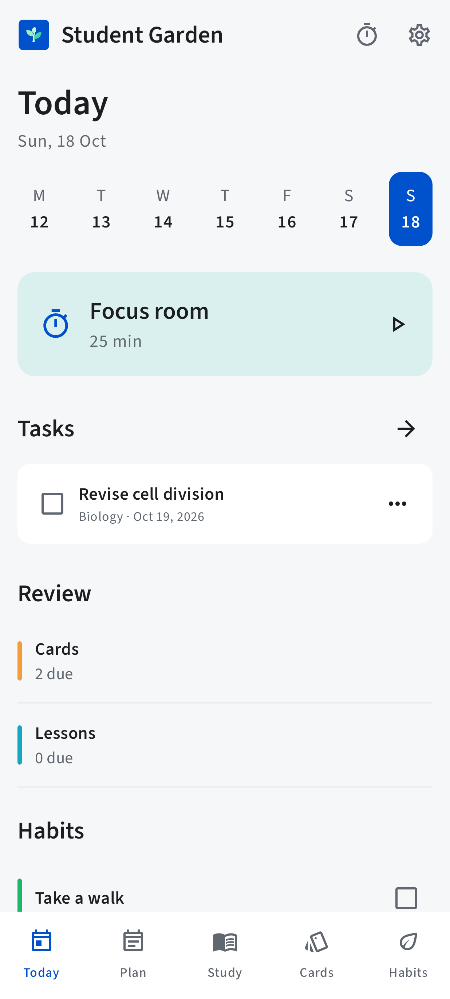
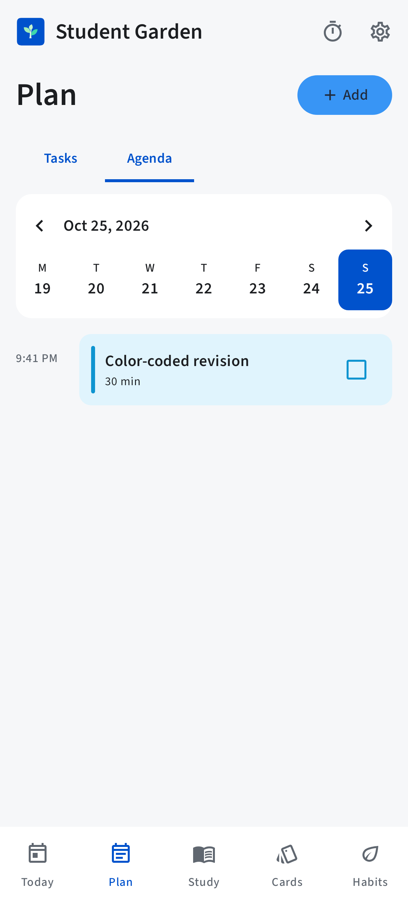
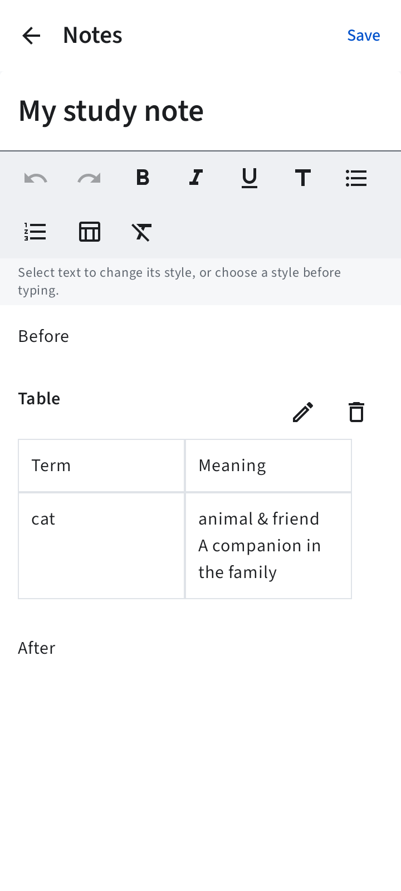
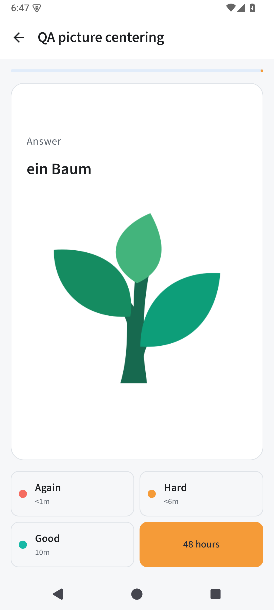
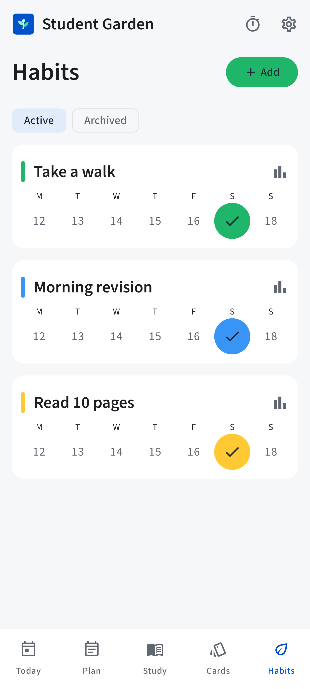
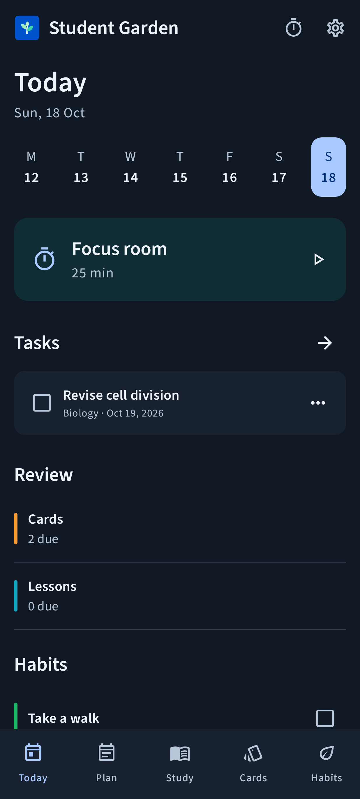

<p align="center">
  
</p>

<h1 align="center">Student Garden</h1>
<p align="center"><strong>A place to plan, learn and keep growing.</strong></p>
<p align="center">An offline Android study organizer for tasks, notes, flashcards, lesson reviews, habits and focused study.</p>
<p align="center">Android 8.0+ · Kotlin & Jetpack Compose · Apache-2.0 · English, العربية, Français, Español</p>

<p align="center">
  <a href="https://github.com/ayoubelarfaoui097-png/student-garden/releases/tag/v0.7.0">Download 0.7.0</a> ·
  <a href="#screenshots">Screenshots</a> ·
  <a href="#build-from-source">Build from source</a> ·
  <a href="PRIVACY.md">Privacy</a> ·
  <a href="CONTRIBUTING.md">Contribute</a>
</p>

Student Garden keeps your study work together on your device. Choose a day, plan a
session, write a note, review what you learned, and build a habit of coming back.
It works without an account, Internet permission, ads, analytics or Google Play Services.

## Screenshots

<table>
  <tr><th>Today</th><th>Agenda</th><th>Notes and tables</th></tr>
  <tr>
    <td></td>
    <td></td>
    <td></td>
  </tr>
</table>

<table>
  <tr><th>Picture review in 0.7.0</th><th>Habits</th><th>Dark appearance</th></tr>
  <tr>
    <td></td>
    <td></td>
    <td></td>
  </tr>
</table>

These are actual app renders and Android emulator captures using fictional study
data. The unchanged screens are from 0.6.0; the picture-review capture is from 0.7.0.
[More screenshots and verification](docs/SCREENS.md).

## Make room for your studies

- **Plan your day.** Organize tasks and courses. Select the day in Agenda, choose a
  time, and give each study session a preset or custom color.
- **Write useful notes.** Use bold, italic, underline, headings, lists and editable
  tables, with Undo and Redo.
- **Remember what you learn.** Create text, image or audio flashcards in decks.
  Record audio with a visible timer and Stop control. Think of the answer, tap to
  reveal it, then choose a review interval.
- **Review lessons over time.** Revisit a lesson after 48 hours, 7 days and one
  calendar month, measured from each completed review.
- **Build a routine.** Track scheduled habits, check-in history and streaks. Use a
  custom focus timer with pause, resume and a completion alert.
- **Get local reminders.** Choose reminder categories and a daily practice time
  for due cards and habits. Tasks, agenda sessions, lessons and focus have their
  own local alerts.
- **Keep control of your data.** Private SQLite storage, local backup export and
  merge-only restore, Trash recovery, and an optional Android screen-lock gate.

Light, dark and system appearance are available. Navigation adapts to wider screens.
The app uses the phone's clock; habits retain their saved time zone.

## What's new in 0.7.0

- Due flashcards start in a shuffled order. The current card stays stable while
  reading, refreshing or rotating the screen.
- A card without a written question hides its empty question area and divider.
  The remaining image, answer and audio controls are vertically centered when
  they fit; long content still scrolls.
- Existing cards, media and review schedules remain compatible. Database schema
  and backup format are unchanged.

**Verified:** 103 automated tests passed; Android lint reported no errors and 42
warnings. API 35 emulator checks confirmed the layout, an eight-card shuffled
review session, and preservation of existing test records.
[Read the test report and its limits](docs/verification.md).

## Install

Download [student-garden-0.7.0-preview.apk](https://github.com/ayoubelarfaoui097-png/student-garden/releases/download/v0.7.0/student-garden-0.7.0-preview.apk)
from the [0.7.0 release](https://github.com/ayoubelarfaoui097-png/student-garden/releases/tag/v0.7.0)
and open it on Android 8.0 or later. Allow installation from your file app if Android asks.

**Updating an existing Preview:** install the APK over Student Garden Preview to
retain its records. The package ID and signing key match the 0.6.0 Preview.
You can also export a backup in Settings before updating.

For reminders, open **Settings → Reminders**, allow notifications, choose your
categories and daily time, and use **Send test notification**. Precise-alarm access
is optional. Android power settings can delay reminders; force-stopping the app
pauses alarms until it is reopened.

### F-Droid

The source includes [F-Droid build metadata](fdroid/metadata/com.jdinohaila.studentgarden.yml),
store descriptions, screenshots and a [packaging guide](fdroid/README.md).
The app is not listed in F-Droid yet; inclusion requires F-Droid's review and build.

The Preview uses `com.jdinohaila.studentgarden.preview`. A future F-Droid build uses
`com.jdinohaila.studentgarden`; export a backup from Preview and import it into that
app to transfer your records. F-Droid signs its own build.

## Build from source

Use **JDK 17**, **Android SDK platform 36** and **build-tools 35.0.0**.
Set `ANDROID_HOME`, or create an untracked `local.properties` with `sdk.dir=…`.

```sh
git clone https://github.com/ayoubelarfaoui097-png/student-garden.git
cd student-garden
git checkout v0.7.0
./gradlew testDebugUnitTest lintDebug assembleDebug assembleRelease
```

| Output | Purpose |
| --- | --- |
| `app/build/outputs/apk/debug/app-debug.apk` | Installable, test-signed Preview |
| `app/build/outputs/apk/release/app-release-unsigned.apk` | Optimized unsigned production build; requires signing before installation |

To install on a connected device with USB debugging enabled:

```sh
adb install -r app/build/outputs/apk/debug/app-debug.apk
```

The Gradle wrapper verifies its distribution checksum. Dependencies have pinned
versions and use Google Maven, Maven Central or the Gradle plugin portal. The
optional `tools/build-local.sh` helper uses a locally configured JDK and SDK.

## Data, backups and limits

Records and media stay in Android's private app storage. Removing the app removes
that local data. Export a backup before uninstalling or changing signing keys;
backup ZIPs contain readable personal content and should be stored privately.
Restore merges new IDs and retains existing records when IDs conflict.

Backups contain active records and referenced media. Restore anything you want
from Trash before exporting. Preferences and a running timer are not transferred.
The separate web project uses a different backup format; there is no automatic
web sync or web-to-Android import.

Notes support up to 50,000 text characters. Tables allow up to 30 rows and 6 columns,
with 5,000 characters per cell. Images are limited to 5 MB, audio files to 10 MB,
recordings to three minutes, and backup imports to 100 MB. The optional screen-lock
gate uses Android device credentials; it does not separately encrypt the database.

## Contribute and license

Bug reports and contributions are welcome through [Issues](https://github.com/ayoubelarfaoui097-png/student-garden/issues)
and pull requests. Read [CONTRIBUTING.md](CONTRIBUTING.md), the [design notes](DESIGN.md)
and [verification details](docs/verification.md) before changing storage or scheduling.

Student Garden is licensed under [Apache-2.0](LICENSE). Bundled fonts use
SIL OFL-1.1. Attribution and dependency licenses are in [NOTICE](NOTICE) and
[licenses/](licenses/). The original editable sapling artwork is in [branding/](branding/).
