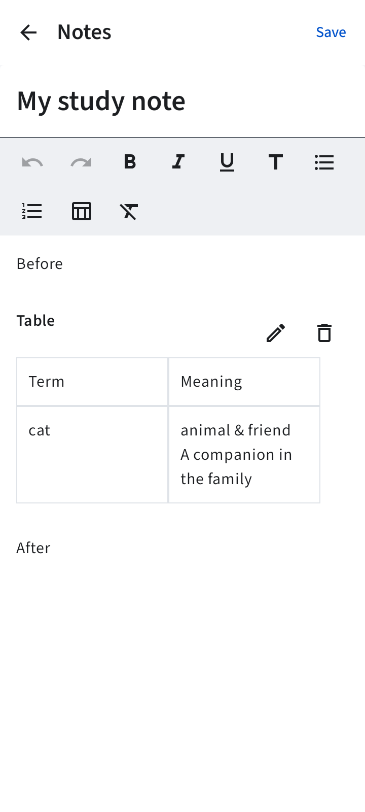
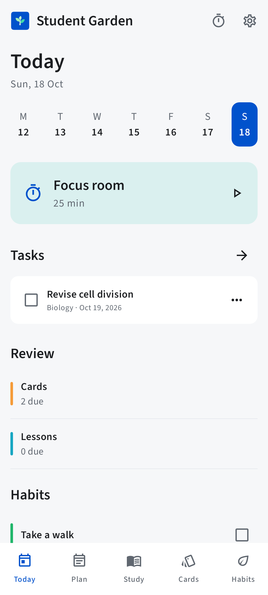
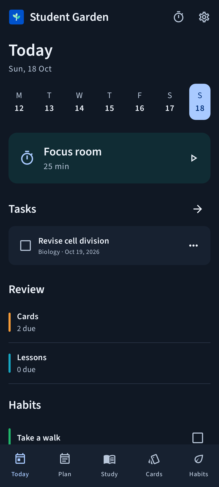

# Student Garden screens

Native Compose renders with fictional test records. The launcher and header use the
original sapling vectors in `branding/`. These images show actual application controls.

## Note formatting

## Native note tables

## Agenda color editor

## Colored agenda session

## Recording status

## Today

## Arabic and dark appearance

Other phone, small-phone and tablet renders are included in the same folder. Separate
emulator captures for this release are documented in `device-checks-0.5.0.md`.

## Version 0.6.0

- [Saved regular/bold comparison on Android](screenshots/0.6/bold-device.png)
- [Real Android notification tray](screenshots/0.6/test-notification-device.png)
- [Current automated rendering evidence](screenshots/0.6/automated/)

## Version 0.7.0

- [Centered picture with no question](screenshots/0.7/blank-question-front-device.png)
- [Centered answer and picture without the empty divider](screenshots/0.7/blank-question-answer-device.png)
- [Observed random review order on Android](review-order-device-0.7.0.json)
