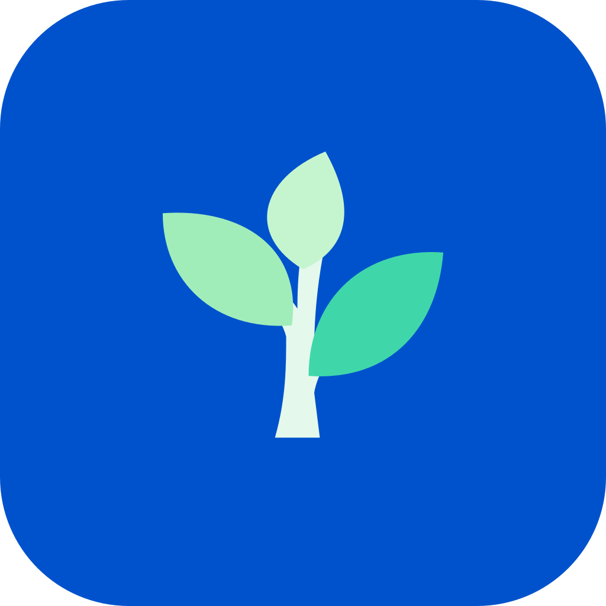
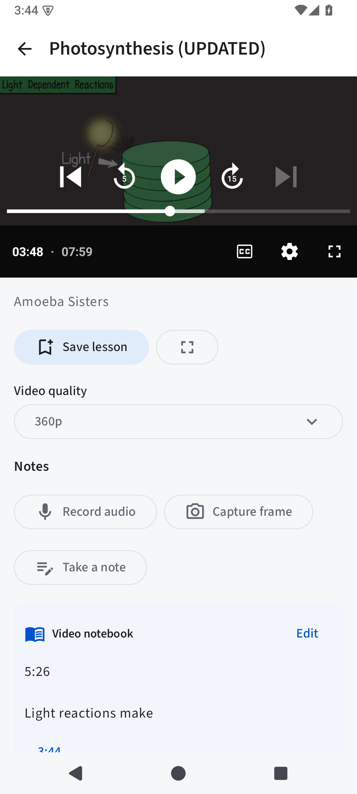
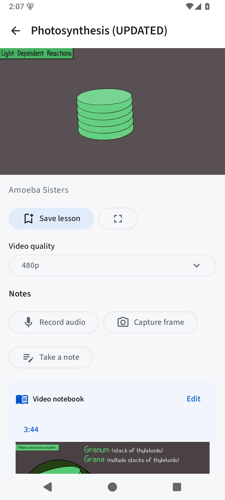
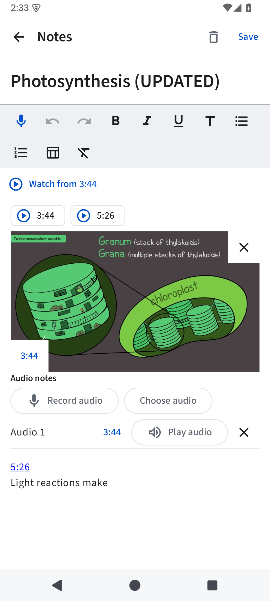

<p align="center">
  
</p>

<h1 align="center">Student Garden</h1>
<p align="center"><strong>A place to plan, learn and keep growing.</strong></p>
<p align="center">Version 0.11.0 · Android 8.0+ · Kotlin & Jetpack Compose</p>
<p align="center">English · العربية · Français · Español</p>

<p align="center">
  <a href="https://github.com/ayoubelarfaoui097-png/student-garden/releases">Releases</a> ·
  <a href="#whats-new-in-0110">What's new</a> ·
  <a href="#screenshots">Screenshots</a> ·
  <a href="#build-from-source">Build from source</a> ·
  <a href="PRIVACY.md">Privacy</a>
</p>

Student Garden brings your study plans, notes, flashcards, lessons and habits into
one Android app. Study records work offline without an account, analytics or
Google Play Services. The optional Video section lets you search public YouTube
lessons and keep notes alongside what you watch.

## What's new in 0.11.0

- **One notebook per video.** Keep written notes, voice recordings, frame captures
  and their timestamps together. Open the same notebook from Study or below the
  video. Older separate video notes are combined while preserving their rich text,
  tables and attachments; groups exceeding notebook limits remain intact.
- **Faster repeat loading.** Recently extracted video information is reused in
  memory, and playback connections are shared to reduce repeated work.
- **Improved playback recovery.** Adaptive startup selects quality up to 720p.
  The player can try a lighter stream or refresh an expired video URL, and offers
  Retry when recovery cannot complete. Higher manual qualities remain available
  when provided by the video.
- **Keep your place.** Changing quality preserves the playback position, speed
  and pause state. Opening a timestamp from a note returns to that moment.
- **Keep the video visible.** The player stays above the scrolling notebook and
  playlist details. Landscape fullscreen hides app navigation and system bars;
  the back arrow returns to portrait.
- **Smaller optimized APK.** The installable Preview is approximately **6.8 MB**.
  It now uses release optimization, including R8 and resource shrinking, while
  keeping the app's features.

Initial loading and video availability still depend on YouTube, your connection
and your device. Cached information improves repeat opens; it does not download
videos for offline playback.

## Your study space

The main navigation is **Today · Video · Study · Cards · Habits**.

| Section | What you can do |
| --- | --- |
| Today | Manage tasks, see due reviews and run a focus session. |
| Video | Search videos, playlists and channels; watch lessons and add timestamped notes. |
| Study | Organize Agenda, Notes, Courses and Lessons in one place. Choose preset or custom colors for lessons and agenda sessions. |
| Cards | Review text, image and audio flashcards in decks. Due cards begin in a shuffled order. |
| Habits | Track scheduled habits, check-ins and streaks. |

### Focused video learning

- Search videos, playlists and channels. Unfiltered results favor videos while
  including relevant playlists and channels.
- Filter by result type, duration, upload date and sort order.
- Browse playlist lessons and channel videos. More results load automatically as
  you approach the end of the list.
- Save videos and resume later. Playback uses NewPipeExtractor and a native
  Media3 player.
- Add written notes, record a voice note or capture a video frame. Each addition
  links back to its source timestamp in the video's notebook.
- Choose the next lesson yourself; there is no automatic next-video feed.

### Notes and review

Write notes with headings, emphasis, lists and editable tables, with Undo and
Redo. Attach images and recorded or imported audio. Microphone recordings in notes
and flashcards show a live waveform, elapsed time and a Stop control.

Lessons support reviews after 48 hours, 7 days and one calendar month, measured
from each completed review. Use the focus timer with pause, resume and a completion
alert to make time for a session.

### Reminders you choose

Open **Settings → Reminders** to allow notifications and choose categories and
your daily study time. Timed tasks and agenda sessions use their deadlines; daily
lesson, card and habit reminders are opt-in. Colored notification artwork helps
distinguish categories, and missed sessions do not trigger surprise catch-up alerts.

Precise-alarm access is optional. Android power settings can delay reminders;
force-stopping the app pauses alarms until it is reopened.

## Screenshots

<table>
  <tr><th>Video playback</th><th>Video notebook</th><th>Combined Study note</th></tr>
  <tr>
    <td></td>
    <td></td>
    <td></td>
  </tr>
</table>

These are actual Android emulator captures using fictional study notes. The
playback and combined-note captures use the optimized Preview; the notebook-below-
player capture uses the functional 0.11.0 candidate. Video imagery belongs to its
respective creator. See [verification details](docs/verification-0.11.0.md) for
the checked workflows and limitations.

## Install or update

For version 0.11.0, the installable file is
**`student-garden-0.11.0-preview.apk`**. It is approximately **6.8 MB** and requires
Android 8.0 or later. Published downloads are available on the
[GitHub Releases page](https://github.com/ayoubelarfaoui097-png/student-garden/releases).

Open the APK on your device and allow installation from your file app if Android
asks. To update an existing Student Garden Preview, install this APK over the
previous version. The provided 0.11.0 Preview keeps the previous Preview package
ID and signing key, so existing notes, recordings and other records are retained.
You can export a backup from Settings before updating.

| Release file | Purpose |
| --- | --- |
| `student-garden-0.11.0-preview.apk` | Optimized, signed and installable Preview. |
| `student-garden-0.11.0-release-unsigned.apk` | Production package for signing with the owner's release key. |
| `student-garden-0.11.0-source.zip` | Source code and supporting project files. |
| `student-garden-0.11.0-SHA256SUMS.txt` | Checksums for the packaged release files. |

The Preview package is `com.jdinohaila.studentgarden.preview`; the production
package is `com.jdinohaila.studentgarden`. They have separate storage. Export and
import a backup when moving between packages.

## Data and privacy

Study records and attachments are stored in Android's private app storage.
Optional video searches and playback require Internet access and contact remote
services. Read [PRIVACY.md](PRIVACY.md) for the full details.

- Export backups locally and restore them by merging records. Existing records
  are retained when imported IDs conflict.
- Backup format 2 includes saved videos and referenced note media. Version 1
  backups remain importable; older app versions cannot import format 2 backups.
- Backups include active records and their referenced attachments. Restore wanted
  records from Trash before exporting. Preferences and a running timer are not
  transferred.
- Backup ZIPs contain readable personal content; store them privately.
- Uninstalling the app removes its local data. Export a backup before uninstalling
  or changing packages or signing keys.

An optional screen-lock gate uses Android device credentials; it does not
separately encrypt the database. The separate web project has a different backup
format and does not sync with the Android app.

## Build from source

Use the **0.11.0 source archive**, **JDK 17**, **Android SDK platform 36** and
**build-tools 35.0.0**. Set `ANDROID_HOME`, or create an untracked
`local.properties` containing `sdk.dir=…`. From the extracted project directory:

```sh
./gradlew testDebugUnitTest lintDebug assemblePreview assembleRelease
```

| Output | Purpose |
| --- | --- |
| `app/build/outputs/apk/preview/app-preview.apk` | Optimized Preview, signed with the local development key. |
| `app/build/outputs/apk/release/app-release-unsigned.apk` | Optimized unsigned production build. |

To install your locally built Preview on a connected device:

```sh
adb install -r app/build/outputs/apk/preview/app-preview.apk
```

A local build may use a different signing key from the distributed Preview.
Android requires matching keys to update an existing installation; keep a backup
when moving between differently signed builds.

For development, `assembleDebug` produces the larger debugging build. Both
`preview` and `release` enable code and resource shrinking. The optional
`tools/build-local.sh` helper uses a locally configured JDK and SDK.

## Verification

The 0.11.0 build completed with **146 tests passing**, zero test failures and
**zero Android lint errors**. Lint reports 66 warnings. Manual API 35 emulator
checks covered updating without clearing data, merged video notes, playback,
timestamp navigation and fullscreen exit.

These checks do not establish performance across all physical devices or network
conditions. Read the [verification report](docs/verification-0.11.0.md),
[build results](docs/build-results-0.11.0.json) and
[playback and notebook details](docs/playback-0.11.0.md).

## Contribute and license

Report bugs or suggest improvements through
[GitHub Issues](https://github.com/ayoubelarfaoui097-png/student-garden/issues).
See [CONTRIBUTING.md](CONTRIBUTING.md) and [DESIGN.md](DESIGN.md) for project guidance.

The combined application is licensed under [GPL-3.0-or-later](LICENSE), including
its NewPipeExtractor integration. Original Apache-2.0 notices are preserved in
[licenses/Apache-2.0.txt](licenses/Apache-2.0.txt). Bundled fonts use SIL OFL-1.1.
See [NOTICE](NOTICE) and [licenses/](licenses/) for attribution.

The source includes [F-Droid metadata](fdroid/metadata/com.jdinohaila.studentgarden.yml)
and a [packaging guide](fdroid/README.md). The app is not listed in F-Droid yet.
