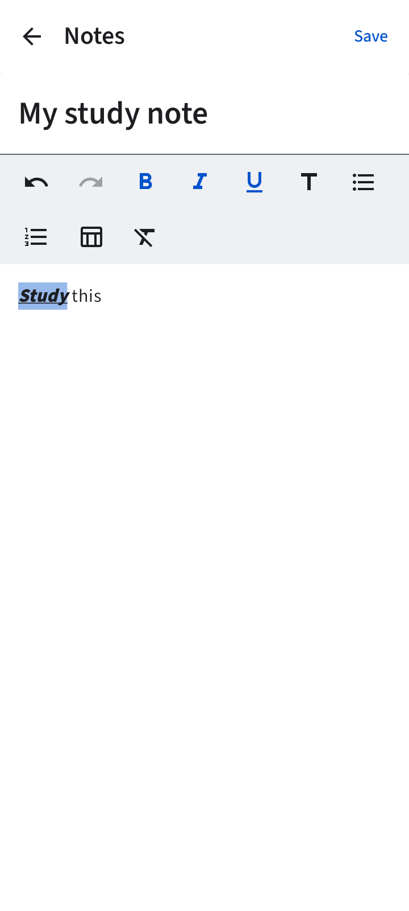
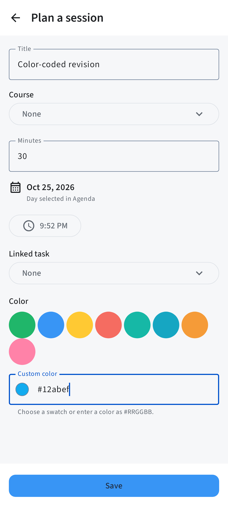
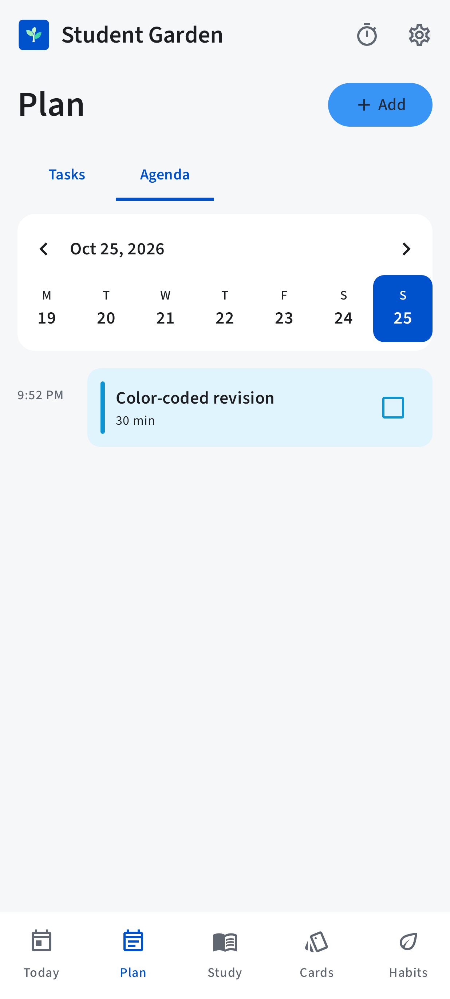
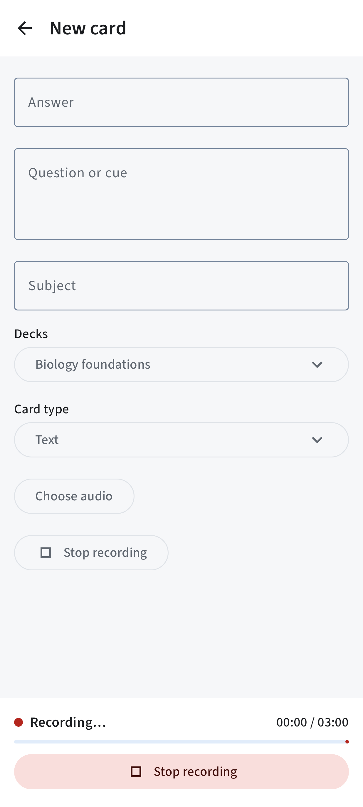
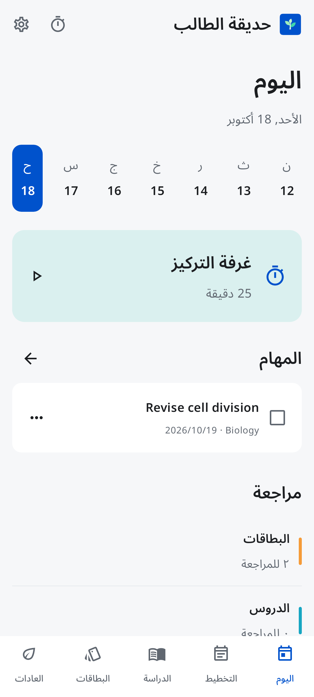

# Student Garden screens

Native Compose renders with fictional test records. The launcher and header use the
original sapling vectors in `branding/`. These images show actual application controls.

## Note formatting

## Native note tables

## Agenda color editor

## Colored agenda session

## Recording status

## Today

## Arabic and dark appearance

Other phone, small-phone and tablet renders are included in the same folder. Separate
emulator captures for this release are documented in `device-checks-0.5.0.md`.

## Version 0.6.0

- [Saved regular/bold comparison on Android](screenshots/0.6/bold-device.png)
- [Real Android notification tray](screenshots/0.6/test-notification-device.png)
- [Current automated rendering evidence](screenshots/0.6/automated/)

## Version 0.7.0

- [Centered picture with no question](screenshots/0.7/blank-question-front-device.png)
- [Centered answer and picture without the empty divider](screenshots/0.7/blank-question-answer-device.png)
- [Observed random review order on Android](review-order-device-0.7.0.json)

## Version 0.8.0

- [Studying with a custom lesson color](screenshots/0.8/studying-lessons.png)
- [Native video player in portrait](screenshots/0.8/video-portrait.png)
- [Landscape fullscreen without app navigation](screenshots/0.8/video-landscape.png)
- [Playback in the optimized release](screenshots/0.8/video-release.png)
- [Verification and limits](verification-0.8.0.md)

## Version 0.9.0

- [Live microphone waveform in an audio note](screenshots/0.9/audio-note-recording.png)
- [Search filters](screenshots/0.9/search-filters.png)
- [Video notes and playlist context](screenshots/0.9/video-notes.png)
- [Landscape fullscreen](screenshots/0.9/video-fullscreen.png)
- [Verification and limits](verification-0.9.0.md)

## Version 0.10.0

- [Playlist thumbnails and spacing](screenshots/0.10/playlists.png)
- [Frame and voice notes](screenshots/0.10/video-frame-and-voice-notes.png)
- [Colored native notification](screenshots/0.10/notification.png)
- [UI direction and skill research](ui-research-0.10.0.md)
- [Verification and limits](verification-0.10.0.md)
